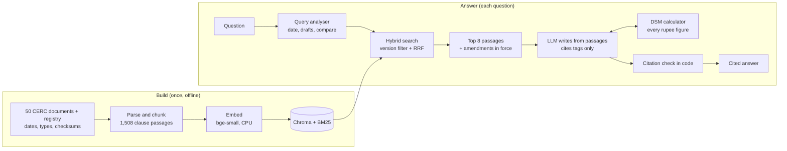

# DSM Regulation Assistant

Grounded answers on India's CERC **Deviation Settlement Mechanism (DSM)** regulations, for the version in force on the date you ask about, with the clause and page for every fact.

**Live demo:** _add your Streamlit link here_ · **Stack:** Python, ChromaDB, BM25, sentence-transformers, Gemini, Streamlit

<!-- Screenshots: add docs/screenshots/ask.png, topic.png, calculator.png and uncomment

-->

## What it does

| Mode | Example | What comes back |
|---|---|---|
| **Ask** | "On 01.06.2024, within how many days did a regional entity have to pay its deviation charges?" | **7 days** under DSM 2022, Reg. 10, with an *Applies* line naming the version and date (not the 10 days of DSM 2024) |
| **Ask + calculator** | "An RE-rich State scheduled at 1,000 MW draws 1,250 MW at 49.95 Hz; NR ₹5.00/kWh. Deviation charge?" | **₹4,06,250 payable**, computed by a deterministic calculator, slab by slab, each with its clause |
| **Out of scope** | "Deviation charges for wind under the Maharashtra (MERC) regulations?" | "Not found in the documents" instead of a guess |
| **Topic brief** | "infirm power" | A cited briefing: rules in force, a dated timeline of every version, related Grid Code rules, the Commission's reasons, and what drafts proposed |
| **DSM calculator page** | entity, schedule, actual, frequency, rate | The charge for one 15-minute block, live, with a breakdown by slab |

## Why it is harder than a chatbot

- **Versions:** DSM 2022 applied until 15.09.2024; DSM 2024 applies from 16.09.2024 and was amended on 23.12.2024, 01.07.2025 and 31.08.2026.
- **Postponed starts:** for example, the TRAS rules in the Ancillary Services Regulations were postponed twice (01.04 → 01.05 → 01.06.2023).
- **Text that is not law:** drafts, explanatory memoranda and Statements of Reasons use the same words as the final rules.
- **Tables:** charge rates are two-column tables (over-injection receivable / under-injection payable) that lose their meaning if split.
- **Arithmetic:** a charge is computed across frequency bands and volume limits, which language models get wrong.

## Architecture



The model never sees text from the wrong date, never builds a citation and never does arithmetic: code filters the passages by date, turns its `[S3]` tags into document, regulation, clause and page, and computes every charge.

## Key design decisions

| Decision | Why |
|---|---|
| **RAG, not fine-tuning** | Fine-tuning teaches style, not facts; a tuned model could not cite, and would go stale with each amendment |
| **Version filter in code** | Every passage carries `effective_from` / `effective_to` from a hand-checked registry; the question's date (or today) filters both searches before the model sees anything |
| **Citations built by code** | The model cites passage tags only; code builds the citation from metadata and flags any tag it was not given |
| **Hybrid search + RRF** | Embeddings match meaning ("sends too much power" ≈ "over-injection"); BM25 matches exact terms ("VLwS", "Reg. 8(4A)"); Reciprocal Rank Fusion merges them |
| **Clause-aware chunks, tables kept whole** | Passages follow regulation/clause boundaries with a breadcrumb; each table cell carries its column label |
| **Amendment expansion** | When a regulation is retrieved, its in-force amendments to the same regulation are added |
| **Calculator as a tool** | 38 hand-worked tests; the model only decides to call it and passes the numbers from the question |
| **Refuse rather than guess** | "Not found in the documents" when no passage is about the question |

## Results

Test set: 25 questions written from the regulation text, kept separate from the 22 development questions used for tuning; graded correct / partial / wrong against key facts. A second run added 5 unseen holdout questions to check the fixes generalised.

| Metric | Run 1 | **Run 2** | Holdout (5 new) | Target |
|---|---|---|---|---|
| Correct / partial / wrong | 18 / 5 / 2 | **21 / 4 / 0** (84%) | 3 / 2 / 0 | ≥ 80% correct |
| Right passage cited | 20 / 23 | **22 / 23** (96%) | 4 / 4 | ≥ 90% |
| Calculations exact | 2 / 3 | **3 / 3** | 1 / 1 | all |
| Refusals correct | 2 / 2 | 2 / 2 | 1 / 1 | all |
| Invented figures | 0 | 0 | 0 | 0 |
| Avg seconds / answer | 2.3 | 3.5 | | < 15 |

Topic briefings: on four topics with 6–8 required items each, briefings cited 85% of the items, all complete, every checked figure correct.

## Problems found and fixed

| Problem | Fix |
|---|---|
| Dashboard tests replaced the index and model with fakes and never restored them; run in the same process, the evaluation would have scored the fake model | Each test file runs in its own process; the evaluation stops unless the real index and model are loaded |
| False refusals on a draft-vs-final question and a calculation, with the right passages present | Refusal only when no passage is relevant; a charge question must call the calculator; one retry after a doubtful refusal |
| "Regulations, 2022" was read as DSM 2022 for GNA and Ancillary Services questions, switching off the date filter | The comparison rule applies only when no other regulation family is named |
| Amendment expansion pulled GNA amendments into a Grid Code answer (same regulation number) | Expansion requires the same principal regulation |
| After adding documents (386 → 1,511 passages) one rate table fell outside the top 5 | 8 passages to the model; re-measured on the dev set (22 / 22) |
| One long document crowded topic briefings | At most 6 places per document, plus a reserved place for each document naming the topic |

## Limitations

- Neighbouring clauses are sometimes missed (Reg. 9(2) without 9(1)); a few answers leave out a secondary condition.
- CERC only: state regulations and RLDC procedures need a jurisdiction filter (designed, not built).
- The official CERC order on factor X (wind/solar sellers from 01.04.2026) could not be obtained; its values come from a published summary, are kept in the calculator, and are named as such in answers. The summary's text is not included in this repository.
- Public demo: free-tier models, limited questions per visitor. **Not legal advice**; check the cited clause.

## Run it locally

```bash
pip install -r requirements.txt
# put GEMINI_API_KEY=... (and optionally GROQ_API_KEY=...) in a .env file in this folder
streamlit run app/dashboard.py
python tests/test_calculator.py      # each test file runs on its own
```

On first start the app builds its Chroma index from `data/embeddings.npy` (passage vectors from `BAAI/bge-small-en-v1.5`, stored at half precision) in a few seconds; questions are embedded with the same model.

## Repository layout

```
app/dashboard.py          Streamlit app (Ask, Topic brief, DSM calculator)
src/dsm_assistant/        ingest, index, retrieve, answer, calculator, topic, llm
tests/                    unit tests (calculator cases worked by hand; fake models)
data/documents.yaml       document registry: type, status, effective dates, source URL
data/chunks.jsonl         1,508 clause-aware passages with metadata
data/embeddings.npy       passage vectors (the index is built from them at start-up)
eval/                     retrieval dev set, evaluation questions, topic checklists
config.yaml               models, retrieval and demo settings
```

Source documents: Central Electricity Regulatory Commission, [cercind.gov.in](https://cercind.gov.in).
